# Домашнее задание «Основы Terraform. Yandex Cloud»

Всё делал на своей VirtualBox Ubuntu, код лежит в папке src рядом с этим файлом. Секреты (cloud_id, folder_id, ssh-ключ) вынесены в personal.auto.tfvars, он в .gitignore и в репозиторий не попал. Ключ сервисного аккаунта лежит вне репозитория: ~/.authorized_key.json.

## Задание 0

Прочитал документацию по группам безопасности (security groups). Это виртуальный файрвол для ВМ: набор правил входящего и исходящего трафика, привязывается к сетевому интерфейсу. При создании сети Yandex Cloud сам создаёт группу по умолчанию, это видно и в плане Terraform: у сети есть атрибут default_security_group_id. В задании я свои группы не создавал, использовал группу по умолчанию.

## Задание 1

Что сделал:
- создал сервисный аккаунт terraform-sa, выдал роль editor на каталог и выпустил ключ в ~/.authorized_key.json;
- свой публичный ssh-ключ (ed25519) положил в переменную vms_ssh_public_root_key через personal.auto.tfvars;
- в providers.tf поменял required_version с "~>1.12.0" на ">= 1.12.0", иначе моя версия Terraform не подходила;
- переименовал переменную с ключом из vms_ssh_root_key в vms_ssh_public_root_key, как просит задание.

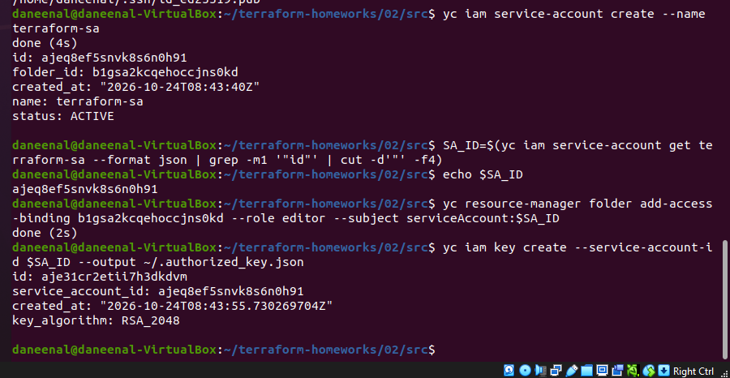

### terraform init

С первого раза init упал: зеркало terraform-mirror.yandexcloud.net отказало в соединении. Это была временная проблема сети, curl к зеркалу отдавал 200, и повторный init прошёл. Потом так же один раз terraform plan не смог получить IAM-токен (i/o timeout), тоже повторил и всё заработало.

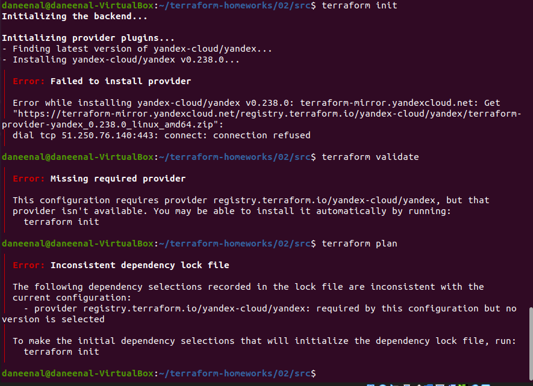

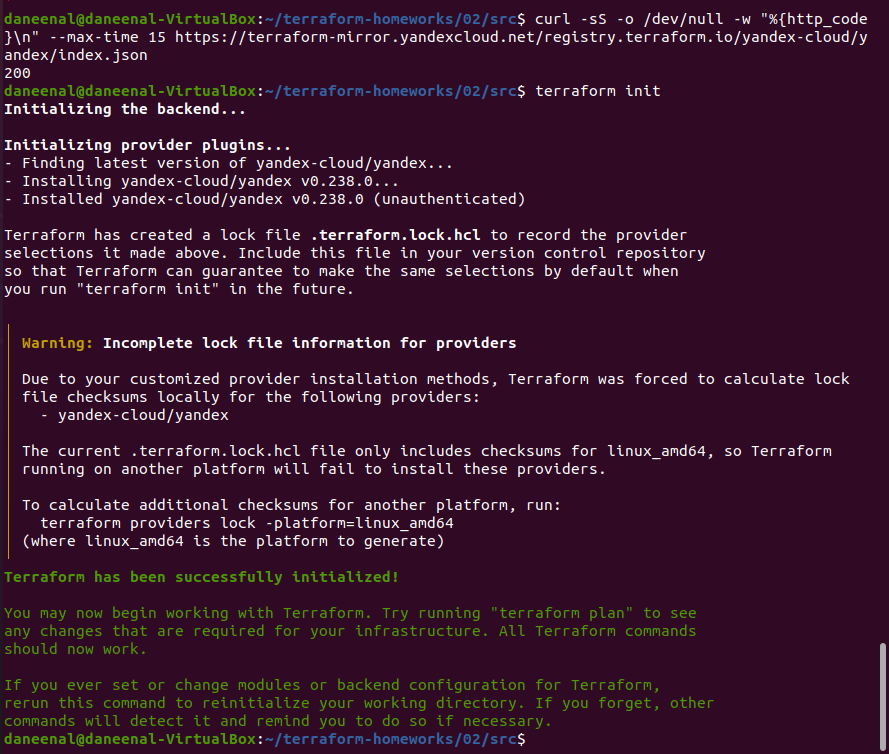

### Ошибки в коде, которые заложены в задании

Нашёл их при terraform apply, их было две.

Ошибка 1: Platform "standart-v4" not found. Суть в том, что в имени платформы опечатка (standart вместо standard), и к тому же платформы v4 вообще нет. Бывают standard-v1, standard-v2, standard-v3. Исправил на standard-v1.

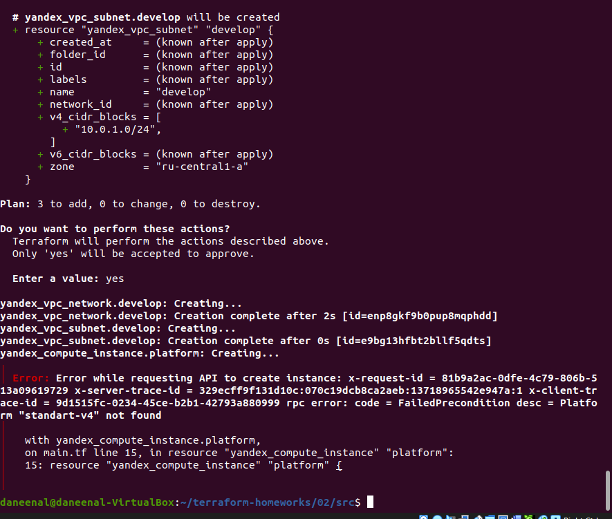

Ошибка 2: the specified number of cores is not available on platform "standard-v1"; allowed core number: 2, 4. Суть в том, что на платформе standard-v1 нельзя создать ВМ с одним ядром, допустимо только 2 или 4. Поменял cores с 1 на 2.

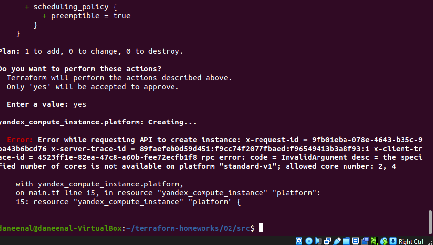

### Ошибка, которая была не в коде

После исправлений apply упал с ResourceExhausted: Resource allocation is restricted. Сначала я думал, что опять что-то не так в конфиге, но это уже другой уровень: облако дошло до выделения ресурсов и отказало.

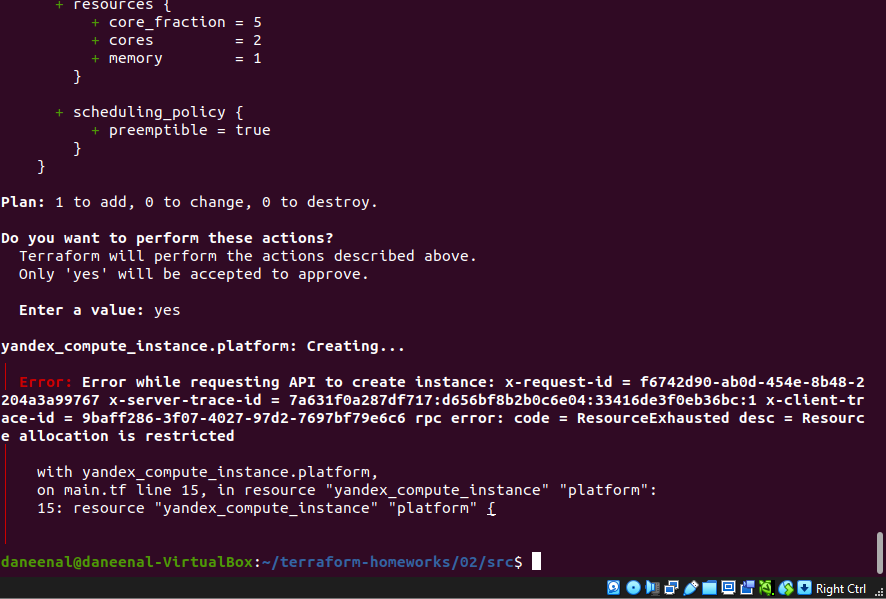

Что проверил:
- платёжный аккаунт в статусе Active, грант действует;
- квоты Compute почти не использованы (vCPU 0 из 6, по 0 из 2 в каждой зоне, RAM 0 из 48 ГБ, ВМ 0 из 12);
- создал ВМ напрямую через yc с теми же параметрами в той же зоне и получил ту же ошибку, значит, Terraform ни при чём.

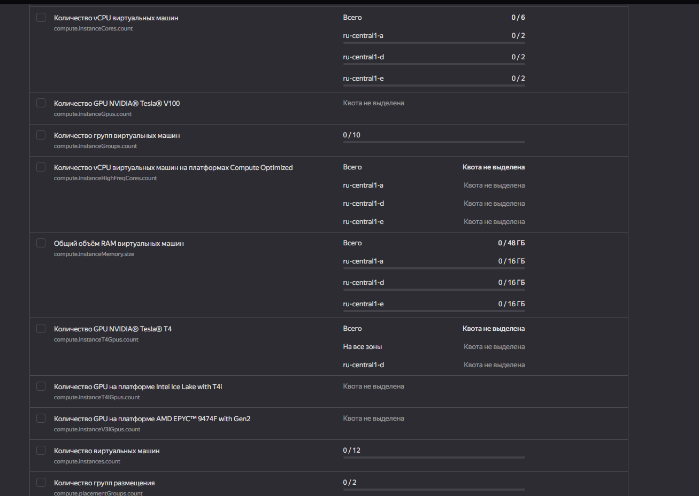

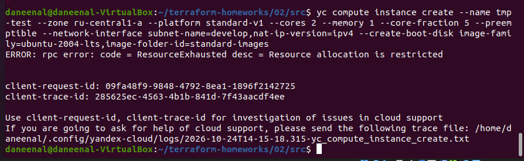

Потом создал тестовую подсеть и ВМ в зоне ru-central1-d через yc, и там всё создалось. Тестовую ВМ и подсеть сразу удалил. Вывод: ограничение действует только на зону ru-central1-a. Поэтому я перевёл проект на зону ru-central1-d. Это повлекло два изменения: в зоне d нет standard-v1, поэтому взял standard-v3, а у v3 минимальная доля ядра 20, поэтому core_fraction стал 20 вместо 5. Зона задаётся в personal.auto.tfvars переменной default_zone.

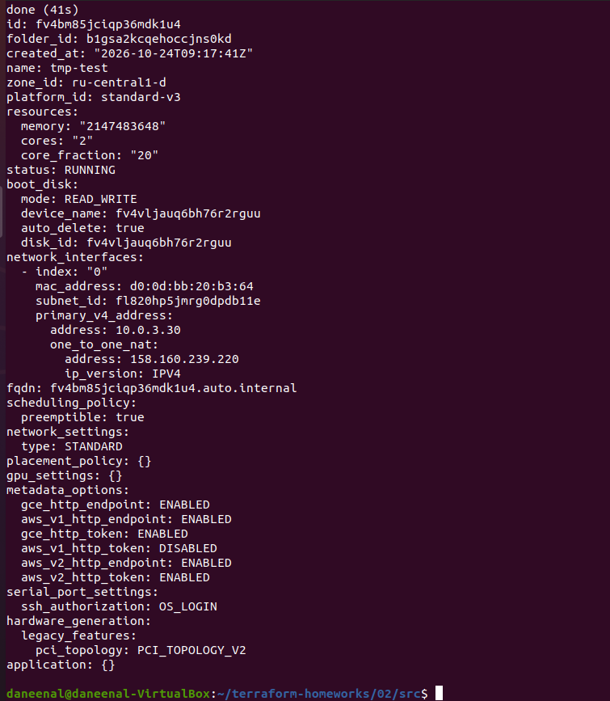

После этого terraform apply прошёл:

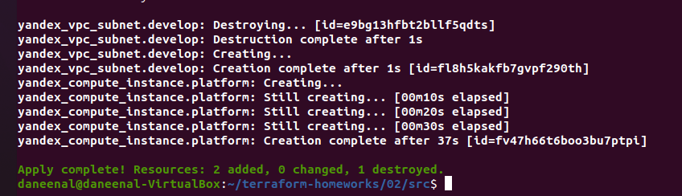

### Скриншот консоли Yandex Cloud и проверка по ssh

В консоли ВМ netology-develop-platform-web в статусе Running, внешний IP 178.154.251.92, зона ru-central1-d:

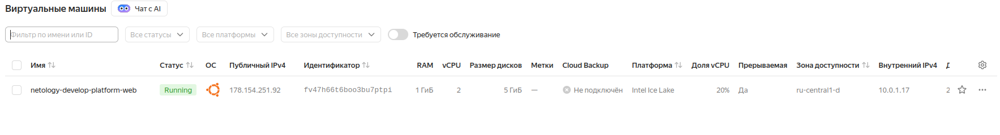

Зашёл по ssh и выполнил curl ifconfig.me, вернулся тот же адрес 178.154.251.92:

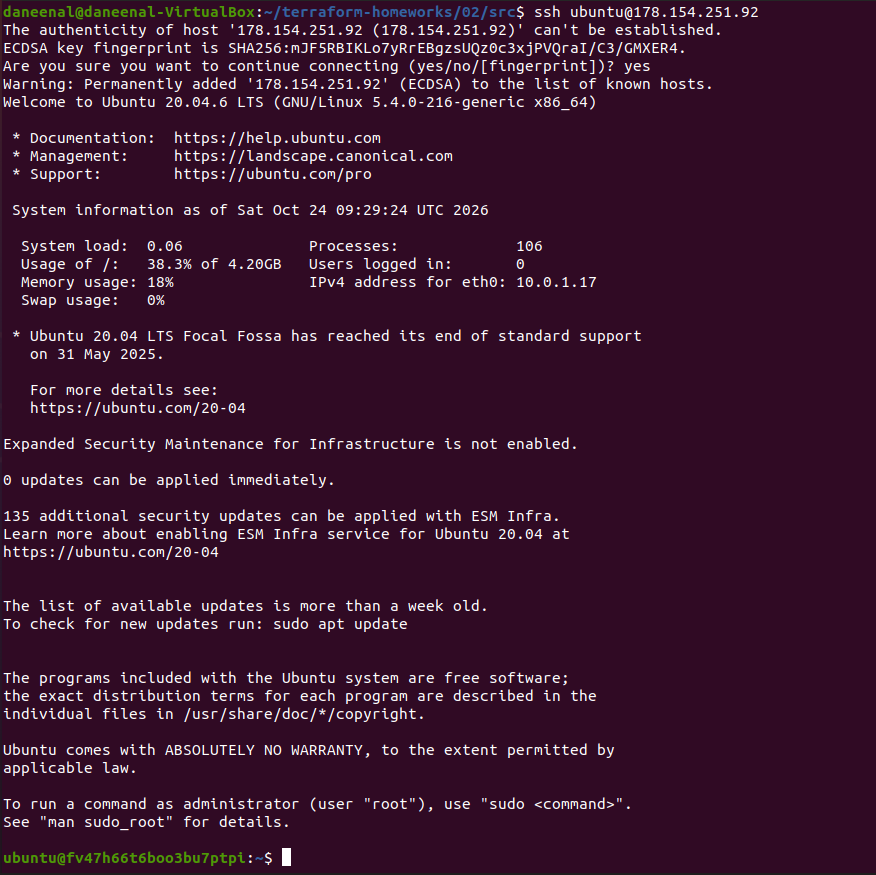

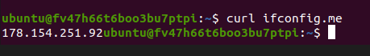

### Почему в обучении полезны preemptible = true и core_fraction = 5

- preemptible = true означает прерываемую ВМ. Она заметно дешевле обычной, но облако может остановить её в любой момент и в любом случае останавливает через 24 часа работы. Для учебных стендов это не страшно, мы всё равно создаём и удаляем ВМ, а деньги гранта тратятся медленнее.
- core_fraction = 5 означает гарантированную долю vCPU 5%. Платишь только за гарантированную часть, поэтому ВМ получается очень дешёвой. Для учебных задач (зайти по ssh, сделать curl) такой мощности хватает. Минус в том, что при нагрузке такая ВМ будет сильно тормозить.
- В итоге у меня из-за платформы v3 было 20%, а не 5%, но смысл тот же.

## Задание 2

Вынес все значения из main.tf в переменные с префиксом vm_web_ (образ, имя, платформа, ядра, память, доля ядра, preemptible, nat, serial-port). Типы указаны, значения по умолчанию равны тем, что были в main.tf. Пример:

```hcl
variable "vm_web_image_family" {
  type        = string
  default     = "ubuntu-2004-lts"
  description = "Image family for the web VM"
}

variable "vm_web_cores" {
  type        = number
  default     = 2
  description = "vCPU count of the web VM"
}
```

В main.tf ресурс теперь ссылается на них, например family = var.vm_web_image_family. terraform plan после замены показывает No changes:

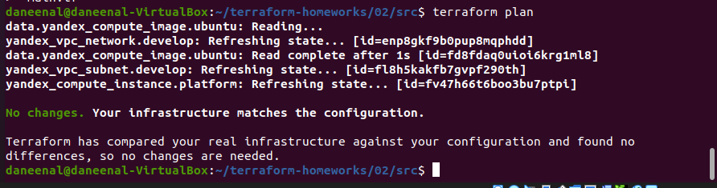

## Задание 3

Создал файл vms_platform.tf и перенёс в него все переменные первой ВМ. Для второй ВМ netology-develop-platform-db добавил переменные с префиксом vm_db_ и ресурс yandex_compute_instance.platform_db: cores = 2, memory = 2, core_fraction = 20.

Отступление от задания: зону ru-central1-b использовать не смог, в моём облаке доступны только ru-central1-a, d и e (это видно и в квотах). Зона d занята первой ВМ, поэтому вторую ВМ поставил в ru-central1-e. Для неё сделал отдельную подсеть develop-db с CIDR 10.0.2.0/24.

```hcl
variable "vm_db_zone" {
  type        = string
  default     = "ru-central1-e"
  description = "Zone of the db VM (ru-central1-b is not available in this cloud)"
}

variable "vm_db_cidr" {
  type    = list(string)
  default = ["10.0.2.0/24"]
}
```

```hcl
resource "yandex_vpc_subnet" "db" {
  name           = "develop-db"
  zone           = var.vm_db_zone
  network_id     = yandex_vpc_network.develop.id
  v4_cidr_blocks = var.vm_db_cidr
}
```

Применил, обе ВМ создались:

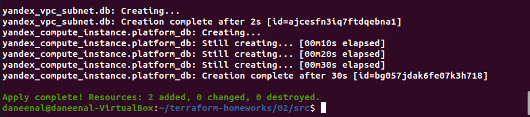

В консоли обе ВМ в статусе Running (скриншот сделан уже после задания 9*, поэтому у ВМ нет публичного IP, это ожидаемо):

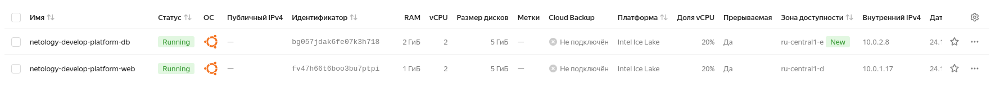

## Задание 4

В outputs.tf сделал один output vms_info со списком из двух словарей, в каждом instance_name, external_ip и fqdn. Ничего не захардкожено, всё берётся из атрибутов ресурсов:

```hcl
output "vms_info" {
  description = "Name, external IP and FQDN of every VM"
  value = [
    {
      instance_name = yandex_compute_instance.platform.name
      external_ip   = yandex_compute_instance.platform.network_interface[0].nat_ip_address
      fqdn          = yandex_compute_instance.platform.fqdn
    },
    {
      instance_name = yandex_compute_instance.platform_db.name
      external_ip   = yandex_compute_instance.platform_db.network_interface[0].nat_ip_address
      fqdn          = yandex_compute_instance.platform_db.fqdn
    }
  ]
}
```

Вывод terraform output:

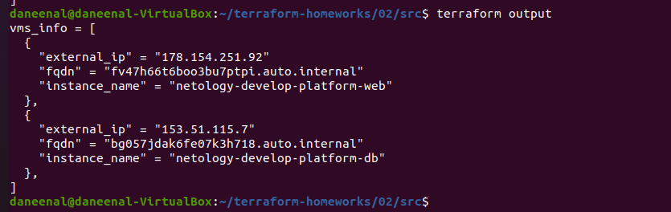

## Задание 5

В locals.tf в одном блоке locals собрал имена ВМ через интерполяцию из трёх переменных: vm_project (netology), vpc_name (develop) и vm_platform_name (platform):

```hcl
locals {
  vm_web_name = "${var.vm_project}-${var.vpc_name}-${var.vm_platform_name}-web"
  vm_db_name  = "${var.vm_project}-${var.vpc_name}-${var.vm_platform_name}-db"
}
```

В ресурсах теперь name = local.vm_web_name и name = local.vm_db_name. Имена получились те же, поэтому plan показал No changes:

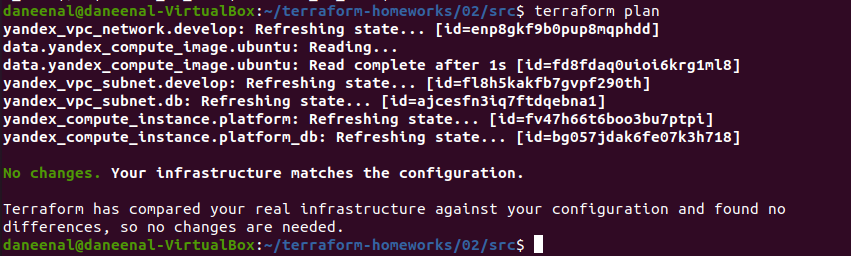

## Задание 6

Сделал в vms_platform.tf одну переменную vms_resources типа map(object) для обеих ВМ (cores, memory, core_fraction, hdd_size, hdd_type) и общую переменную metadata:

```hcl
variable "vms_resources" {
  type = map(object({
    cores         = number
    memory        = number
    core_fraction = number
    hdd_size      = number
    hdd_type      = string
  }))
  default = {
    web = { cores = 2, memory = 1, core_fraction = 20, hdd_size = 5, hdd_type = "network-hdd" }
    db  = { cores = 2, memory = 2, core_fraction = 20, hdd_size = 5, hdd_type = "network-hdd" }
  }
}

variable "metadata" {
  type = map(string)
  default = {
    serial-port-enable = "1"
    ssh-keys           = "set real value in personal.auto.tfvars"
  }
}
```

В ресурсах значения берутся как var.vms_resources["web"].cores и так далее, а metadata = var.metadata. Реальный ssh-ключ в metadata лежит в personal.auto.tfvars, потому что в default переменной другую переменную использовать нельзя, а в репозиторий ключ класть не хотелось.

Переменные, которые стали не нужны (vm_web_name, vm_web_cores, vm_web_memory, vm_web_core_fraction, vm_web_serial_port_enable и такие же vm_db_*), закомментировал в vms_platform.tf. Переменную vms_ssh_public_root_key закомментировал в variables.tf.

terraform plan показывает No changes:

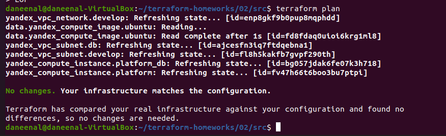

## Задание 7*

Работал в terraform console с файлом console.tf.

1. Второй элемент списка test_list: local.test_list[1], ответ "staging".
2. Длина списка: length(local.test_list), ответ 3.
3. Значение ключа admin из test_map: local.test_map["admin"], ответ "John".
4. Строка с интерполяцией:

```
"${local.test_map["admin"]} is admin for ${local.test_list[length(local.test_list)-1]} server based on OS ${local.servers["production"]["image"]} with ${local.servers["production"]["cpu"]} vcpu, ${local.servers["production"]["ram"]} ram and ${length(local.servers["production"]["disks"])} virtual disks"
```

Получилось: "John is admin for production server based on OS ubuntu-20-04 with 10 vcpu, 40 ram and 4 virtual disks".

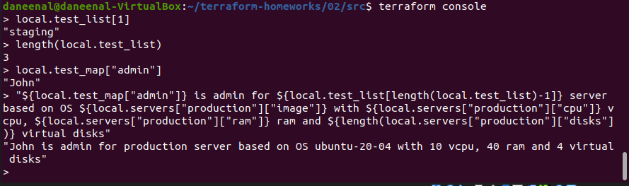

## Задание 8*

Значение положил в terraform.tfvars как в задании (там только условные IP из текста задания, секретов нет). Переменная test с полным описанием типа: список словарей, значения которых списки строк:

```hcl
variable "test" {
  type = list(map(list(string)))
}
```

Выражение в terraform console, которое достаёт нужную строку: var.test[0]["dev1"][0]

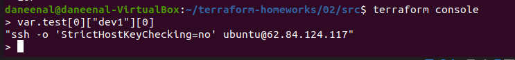

## Задание 9*

Сначала, пока у ВМ ещё был внешний IP, зашёл на каждую по ssh и задал пароль: sudo passwd ubuntu.

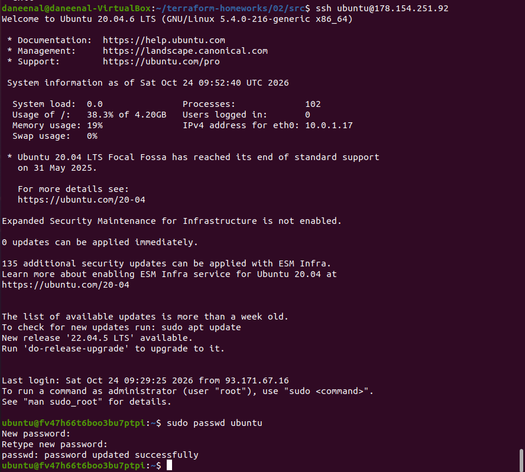

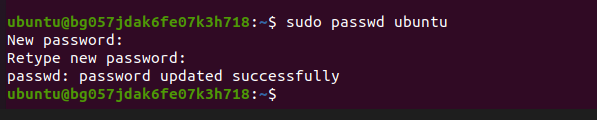

Потом добавил в main.tf NAT-шлюз и таблицу маршрутов и привязал таблицу к обеим подсетям (route_table_id):

```hcl
resource "yandex_vpc_gateway" "nat_gateway" {
  name = "develop-gateway"
  shared_egress_gateway {}
}

resource "yandex_vpc_route_table" "rt" {
  name       = "develop-route-table"
  network_id = yandex_vpc_network.develop.id

  static_route {
    destination_prefix = "0.0.0.0/0"
    gateway_id         = yandex_vpc_gateway.nat_gateway.id
  }
}
```

Внешние IP убрал через personal.auto.tfvars (vm_web_nat = false и vm_db_nat = false), код менять не пришлось. В репозитории по умолчанию nat = true.

План: 2 добавить (шлюз и таблица маршрутов), 4 изменить (две подсети и две ВМ), 0 удалить:

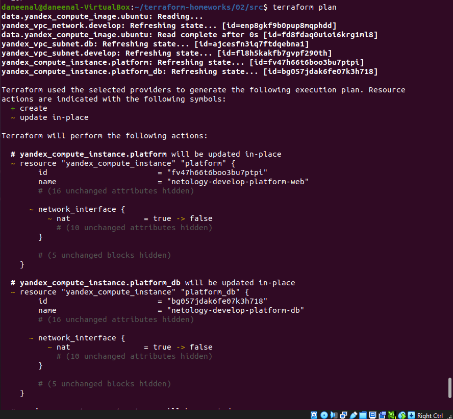

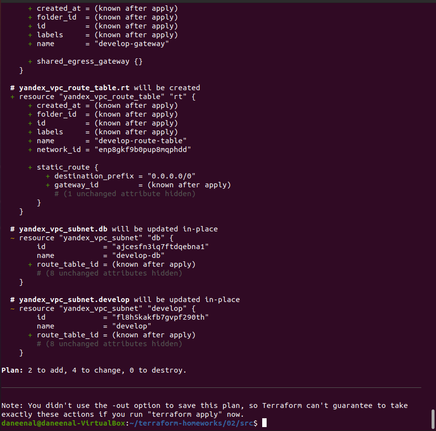

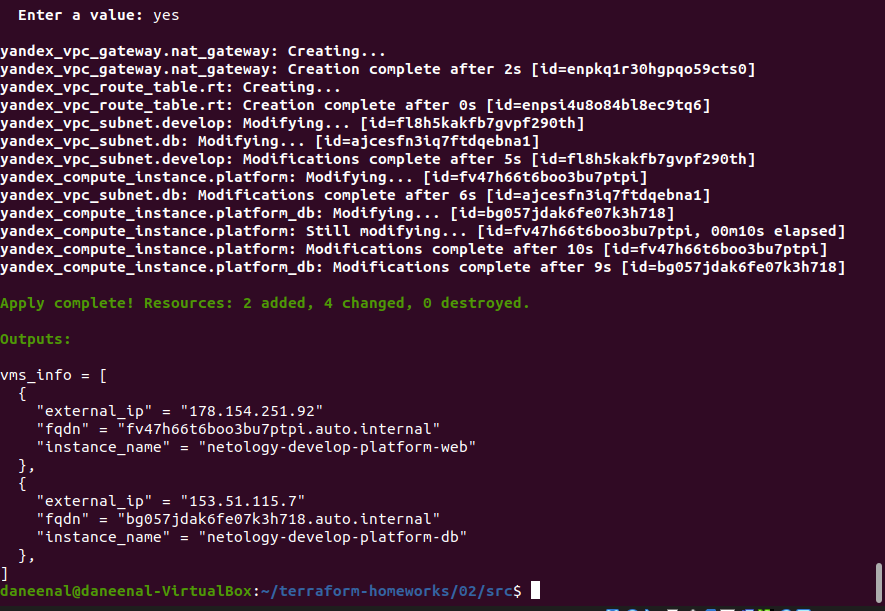

Заметил странность: в outputs сразу после этого apply ещё выводились старые внешние IP. Думаю, это просто не обновившееся значение, потому что в консоли у ВМ публичного IPv4 уже нет (скриншот в задании 3).

Проверка интернета через серийную консоль: вошёл как ubuntu с паролем, ping ya.ru проходит без потерь, а curl ifconfig.me вернул 185.206.167.157. Это не адрес ВМ (у неё его больше нет), а адрес NAT-шлюза, значит, трафик идёт через шлюз.

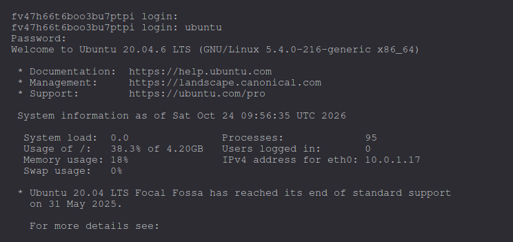

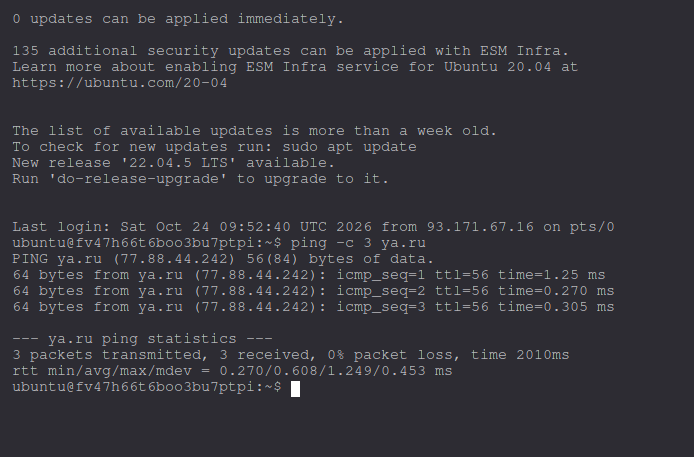

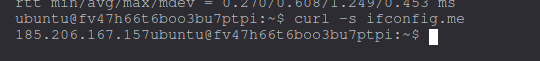

## Удаление ресурсов

После проверки сделал terraform destroy, удалились все 7 ресурсов (две ВМ, две подсети, таблица маршрутов, шлюз, сеть). Тестовые ВМ и подсеть, которые я создавал через yc, удалил сразу после проверки зоны. Сервисный аккаунт terraform-sa и его ключ тоже удалил.

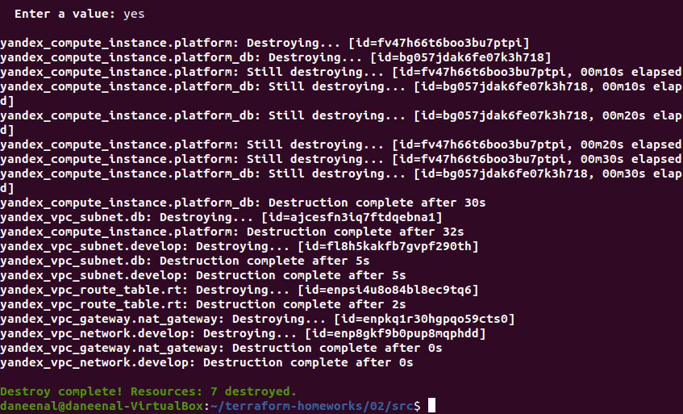
