# Домашнее задание «Управляющие конструкции в коде Terraform»

Ветка: terraform-03. Код лежит в папке src рядом с этим файлом. Личные данные (cloud_id, folder_id, зона) вынесены в personal.auto.tfvars, он в .gitignore и в репозиторий не попал. Ключ сервисного аккаунта лежит вне репозитория (~/.authorized_key.json).

Версия Terraform у меня 1.16.7, поэтому ограничение "~>1.12.0" (разрешает только 1.12.x) мне не подходит. В providers.tf я заменил его на ">= 1.12.0".

## Подготовка

Что пришлось сделать до самого задания:
- Создал новый сервисный аккаунт terraform-sa (прошлый я удалил вместе с ресурсами прошлого задания), выдал роль editor на каталог и выпустил ключ.
- В исходном проекте провайдер настроен на OAuth-токен (token = var.token). Я перевёл его на ключ сервисного аккаунта (service_account_key_file), как в прошлом задании, а переменную token убрал, чтобы не обновлять токен каждые 12 часов.
- Создал ветку terraform-03.
- Зону default_zone поставил ru-central1-d в личном файле: в зоне a облако отказывает в выделении ВМ (ResourceExhausted), а зона b недоступна (это я выяснил в прошлом задании). Все ресурсы этого задания находятся в зоне d.

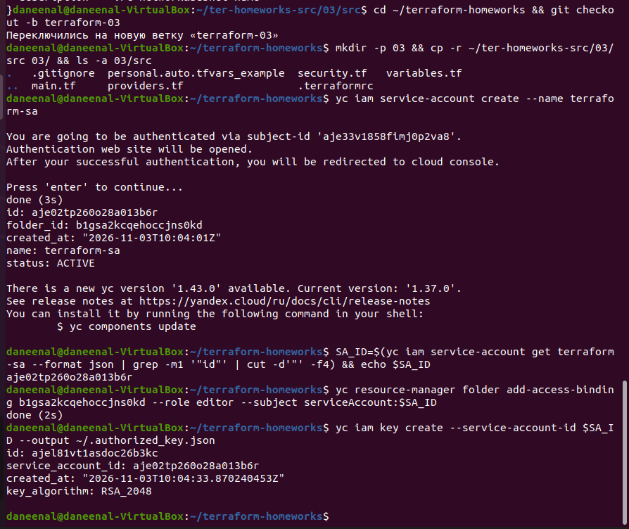

### Квоты

Для задания нужно сразу пять ВМ (web-1, web-2, main, replica, storage), это около 12 vCPU и 33 ГБ дисков. Моя квота была 8 vCPU всего и по 2 vCPU на зону, диски 20 ГБ на зону. Этого не хватало, поэтому я отправил запрос на увеличение квот: vCPU в зоне d до 16 и HDD в зоне d до 40 ГБ. Квоты применились сразу.

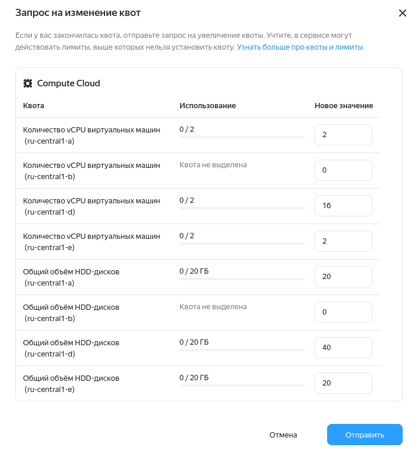


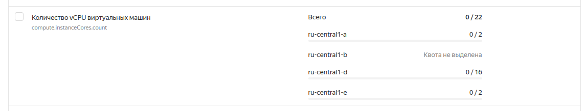

## Задание 1

В проекте из 03/src было три ресурса: сеть develop, подсеть develop (зона и CIDR берутся из переменных) и группа безопасности example_dynamic. Правила группы описаны переменными security_group_ingress и security_group_egress (списки объектов), а в ресурсе они превращаются в блоки через dynamic и for_each. По умолчанию: входящие TCP 22, 80, 443 с 0.0.0.0/0 и исходящий весь трафик.

Файлы providers.tf и .gitignore после моих правок (ключ вместо токена, версия, personal.auto.tfvars в игноре):

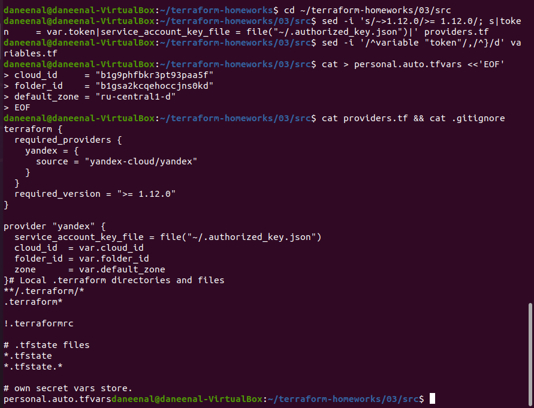

Инициализация и план:

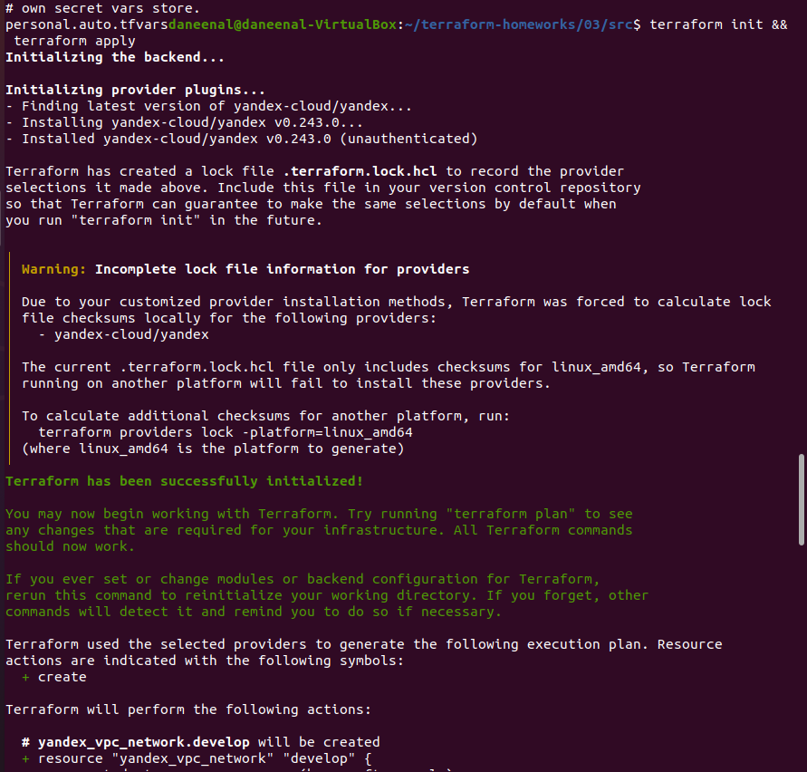

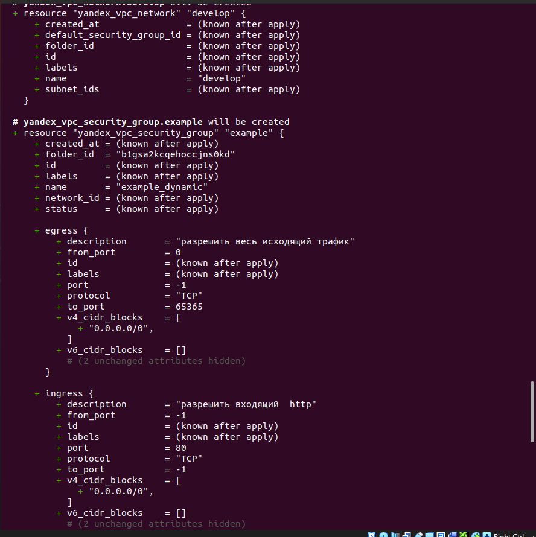

Apply создал 3 ресурса:

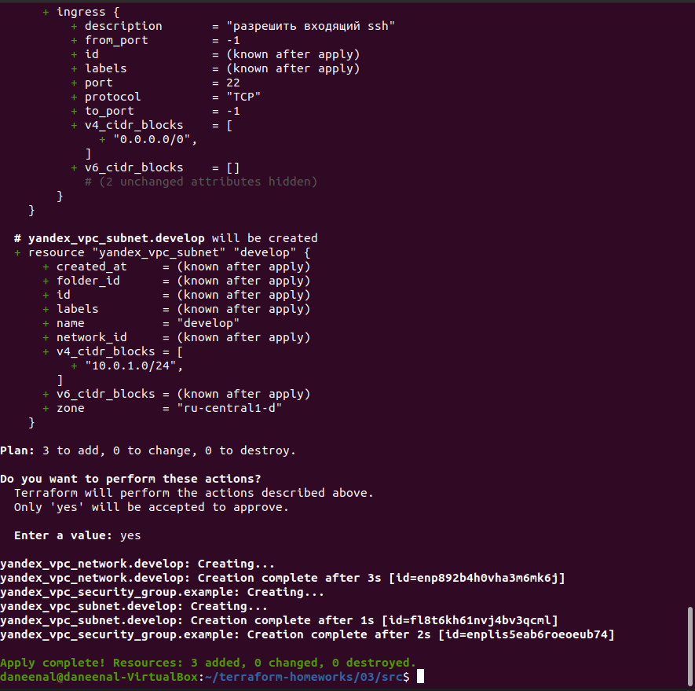

Скриншот входящих правил группы безопасности в консоли Yandex Cloud (порты 22, 80 и 443):

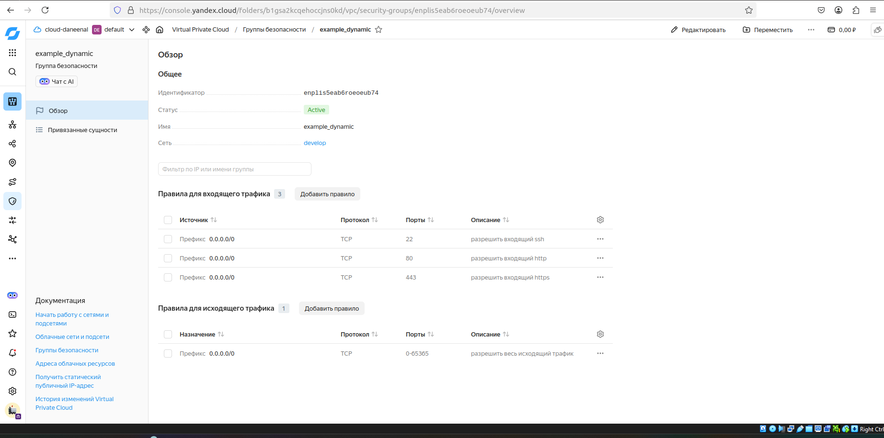

## Задание 2

Весь код вынесен в переменные, хардкода в ресурсах нет: образ, платформа, прерываемость, доля ядра, пользователь, путь к ключу, параметры ВМ.

**count-vm.tf.** Две одинаковые ВМ web-1 и web-2. Имя собирается как префикс плюс count.index + 1, поэтому нумерация начинается с 1, а не с 0. Параметры минимальные: 2 vCPU (меньше на standard-v3 нельзя), 1 ГБ памяти, доля ядра 20% (минимум для v3), диск 5 ГБ, ВМ прерываемые. Группа безопасности example_dynamic из задания 1 назначена через security_group_ids в network_interface.

**for_each-vm.tf.** ВМ main и replica создаются через for_each по общей переменной each_vm (тип из задания). Список объектов преобразуется в словарь по имени: for_each = { for vm in var.each_vm : vm.vm_name => vm }. Ресурсы у них разные: main 4 vCPU, 4 ГБ, диск 10 ГБ; replica 2 vCPU, 2 ГБ, диск 5 ГБ.

**Порядок создания.** Чтобы ВМ из count-vm.tf создавались после ВМ из for_each-vm.tf, в ресурсе web указан depends_on = [yandex_compute_instance.db]. В логе apply видно, что сначала создались main и replica, и только потом web-1 и web-2:

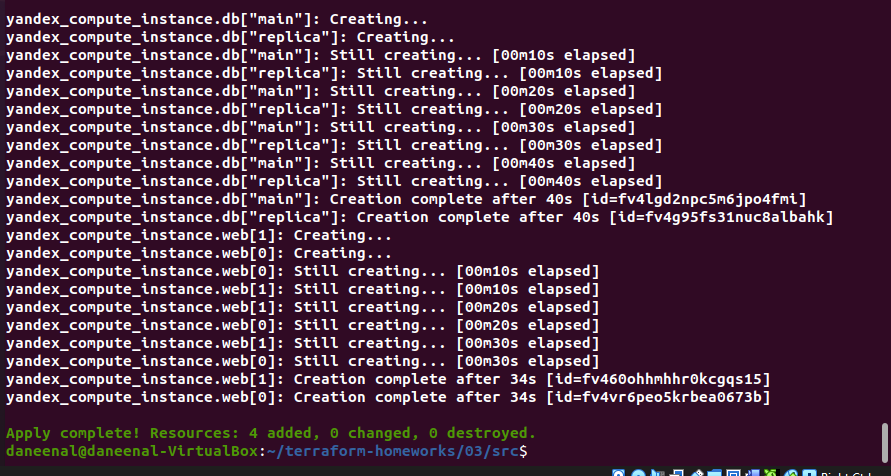

**Ключ.** Путь к открытому ключу лежит в переменной ssh_public_key_path, чтение делается функцией file в locals.tf (local.ssh_public_key), а metadata собирается из него. В задании указан ~/.ssh/id_rsa.pub, а у меня ключ ed25519, поэтому путь по умолчанию ~/.ssh/id_ed25519.pub.

Все ВМ в консоли после этого и следующих заданий (скриншот сделан, когда уже была создана ВМ storage):

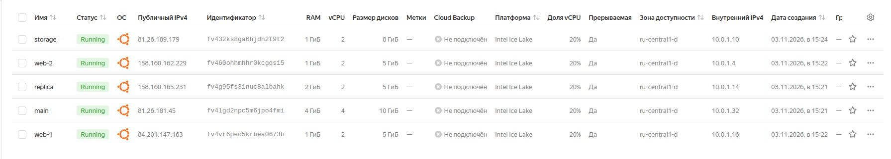

## Задание 3

В файле disk_vm.tf:
- Три одинаковых диска по 1 ГБ создаются через count в ресурсе yandex_compute_disk (имена disk-1, disk-2, disk-3, параметры в переменной extra_disks).
- Одиночная ВМ storage без count и for_each (параметры в переменной storage_vm). Диски подключаются блоком dynamic "secondary_disk" с for_each = yandex_compute_disk.storage, внутри content указан disk_id = secondary_disk.value.id.

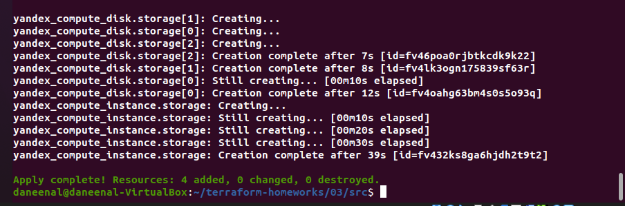

Диски в консоли, все три подключены к ВМ storage:

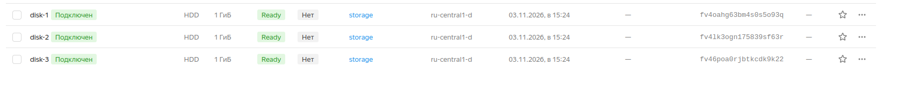

## Задание 4

В ansible.tf ресурс local_file собирает inventory из шаблона hosts.tftpl функцией templatefile. В шаблон передаются три группы ВМ: webservers (ресурс web из count), databases (values(yandex_compute_instance.db), потому что db это словарь из for_each) и storage (одиночная ВМ, обёрнутая в список). Внутри шаблона цикл for перебирает любое количество ВМ, поэтому инвентарь работает и для двух, и для 999 машин. Для каждой ВМ выводятся имя, внешний IP (ansible_host) и FQDN (fqdn).

Тут я сделал ошибку. Сначала взял шаблон из лекции со знаком ~ с обеих сторон директив (%{~ for ... ~}). Знак ~ вырезает переводы строк, и все ВМ склеились в одну строку:

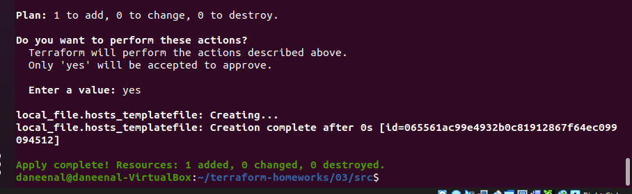

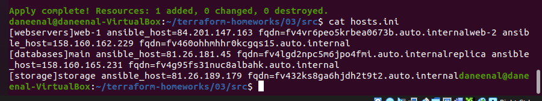

Исправил: убрал лишние ~, чтобы перевод строки после каждой ВМ сохранялся. Итоговый hosts.ini (три группы, пять ВМ, у каждой ansible_host и fqdn):

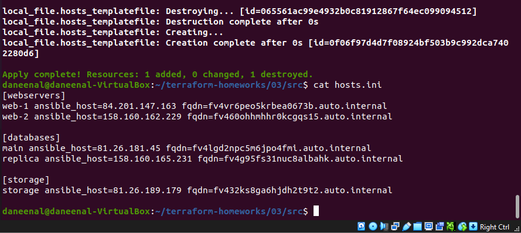

## Задание 5*

Output vms_info собирает список словарей name, id, fqdn через for-выражения по ресурсам web и db. Хардкода нет, он сам подстроится под любое количество ВМ:

```hcl
output "vms_info" {
  description = "Name, id and internal fqdn of VMs created with count and for_each"
  value = concat(
    [for vm in yandex_compute_instance.web : {
      name = vm.name
      id   = vm.id
      fqdn = vm.fqdn
    }],
    [for vm in values(yandex_compute_instance.db) : {
      name = vm.name
      id   = vm.id
      fqdn = vm.fqdn
    }]
  )
}
```

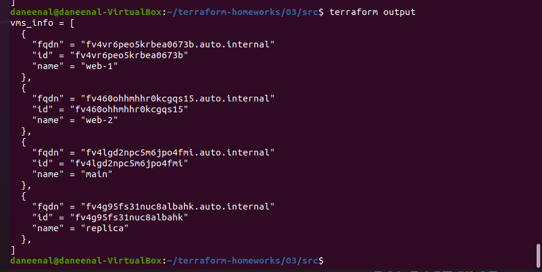

## Задание 6*

Через null_resource и local-exec запускается ansible-playbook по inventory. Плейбук playbook.yml проверяет связь (ping) и выводит переменную fqdn из inventory. В провизионере стоит on_failure = continue, чтобы apply не падал, когда ВМ недоступны (см. ниже), а ANSIBLE_HOST_KEY_CHECKING отключён, чтобы Ansible не спрашивал про отпечатки ключей. Ресурс перезапускается при изменении содержимого inventory (triggers).

В шаблоне hosts.tftpl ansible_host теперь выбирается функцией coalesce: берётся внешний IP, а если его нет (nat = false), то внутренний.

Пока у ВМ были внешние адреса, Ansible подключился ко всем пяти (ok=2, unreachable=0). Warning про одинаковые имя хоста и группы storage появился потому, что ВМ и группа в примере из задания называются одинаково, на работу он не влияет.

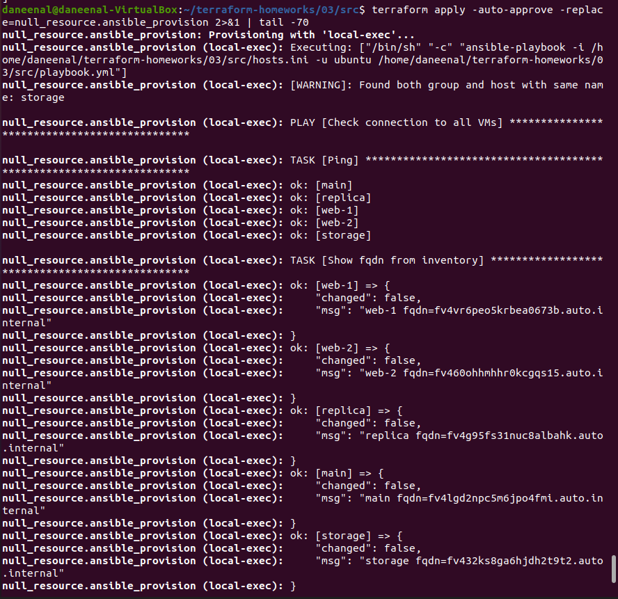

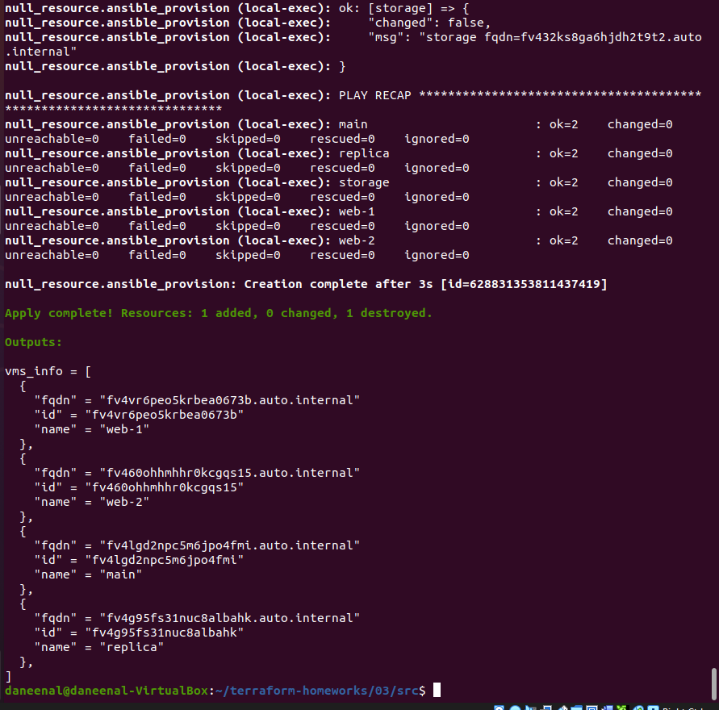

Потом я убрал внешние адреса (vm_nat = false в личном файле). Тут снова вышла неожиданность: после первого apply ВМ уже были без внешних IP (5 changed), но hosts.ini остался со старыми внешними адресами. Причина в том, что содержимое файла вычисляется на этапе плана по старым значениям из состояния. Второй apply увидел обновлённое состояние и пересоздал файл.

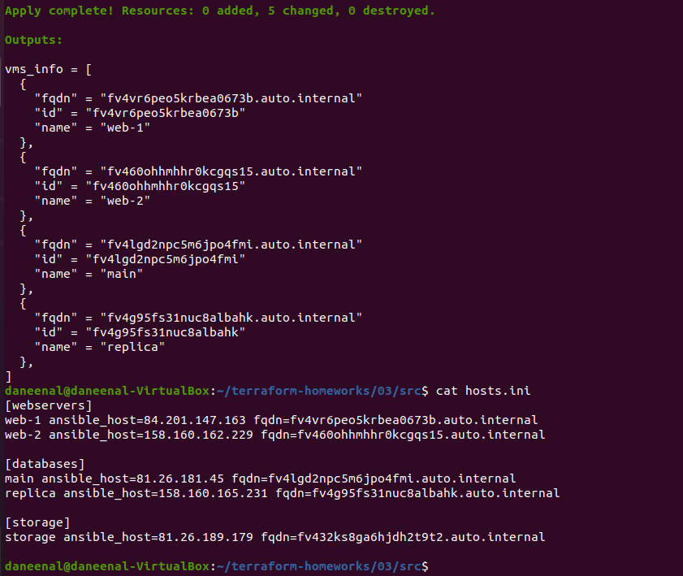

После второго apply в inventory внутренние адреса (10.0.1.x), а Ansible с моей машины до них не достучался (unreachable=1 у каждой ВМ): внутренние адреса снаружи недоступны, такой вариант работает через bastion-сервер.

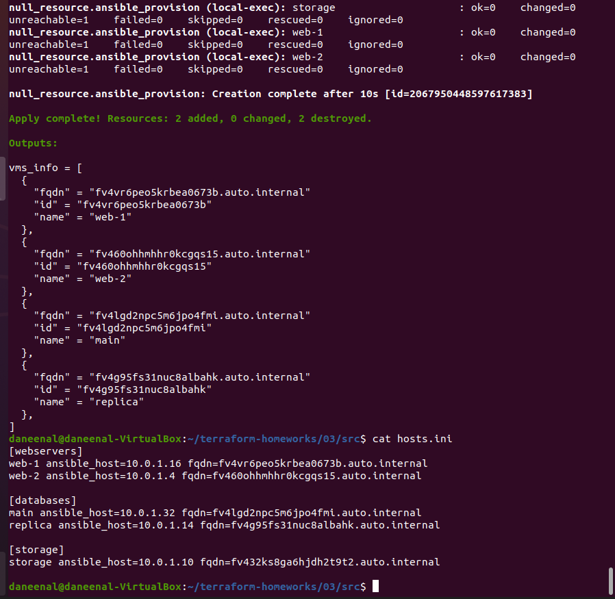

## Задание 7*

Для проверки создал в console.tf переменную local.vpc из задания. Выражение, которое убирает третий элемент (индекс 2) из subnet_ids и subnet_zones, а network_id оставляет как есть:

```
merge(local.vpc, { subnet_ids = [for i, v in local.vpc.subnet_ids : v if i != 2], subnet_zones = [for i, v in local.vpc.subnet_zones : v if i != 2] })
```

merge заменяет два ключа, а for-выражение с условием i != 2 отбрасывает элемент с индексом 2.

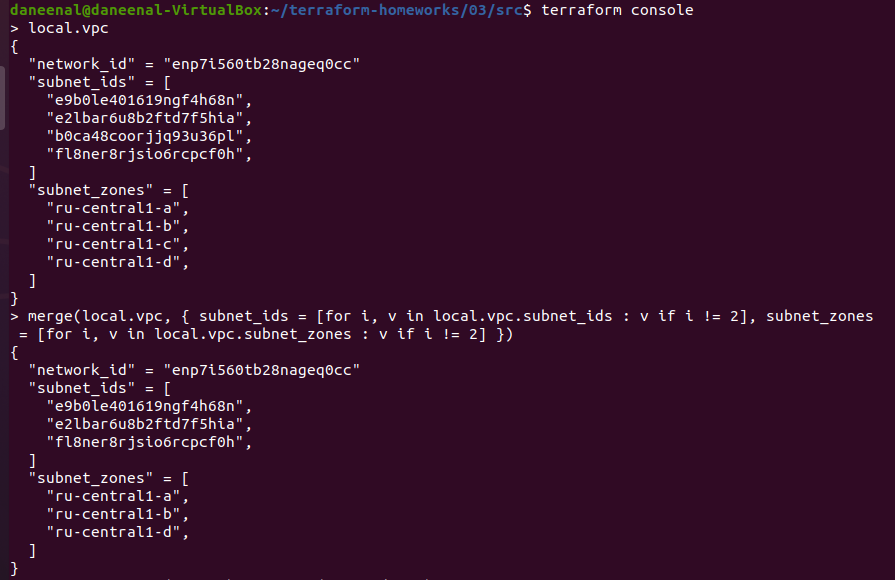

## Задание 8*

В шаблоне из задания три ошибки в строке 3, terraform сам показал место первой: hosts_broken.tftpl:3,85-86 Invalid character.
1. После "nat_ip_address"] не закрыта интерполяция (нет }), поэтому следующий ${ на позиции 85-86 парсер считает недопустимым символом. Это то, на что указал Terraform.
2. В конце строки лишняя закрывающая скобка }.
3. В ключе "platform_id " внутри кавычек лишний пробел, такого атрибута у ВМ нет.

Исправленный шаблон выдал нормальный результат: имена ВМ, внешние адреса и platform_id=standard-v3. Заодно я убрал ~, чтобы строки не склеивались (как в задании 4). Оба шаблона лежат в папке task8.

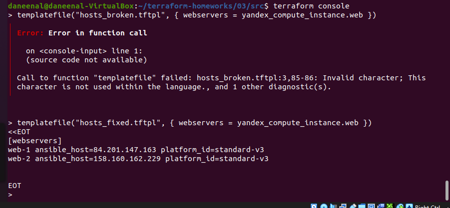

## Задание 9*

Первый список, от rc01 до rc99: форматирую числа от 1 до 99 как rc и два знака:

```
[for i in range(1, 100) : format("rc%02d", i)]
```

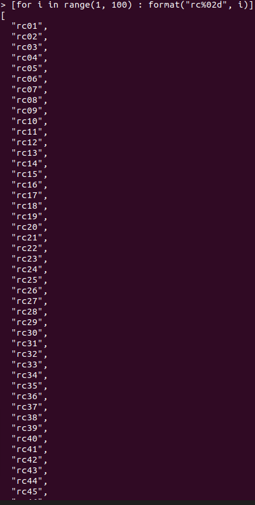

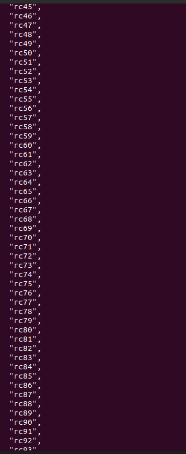

Второй список, от rc01 до rc96, без номеров на 0, 7, 8, 9, кроме rc19. Условие в for: последняя цифра (i % 10) не входит в [0, 7, 8, 9] или i равно 19:

```
[for i in range(1, 97) : format("rc%02d", i) if !contains([0, 7, 8, 9], i % 10) || i == 19]
```

На скриншотах видно rc01-rc06, rc11-rc16, rc19, rc21-rc26 и так далее до rc96.

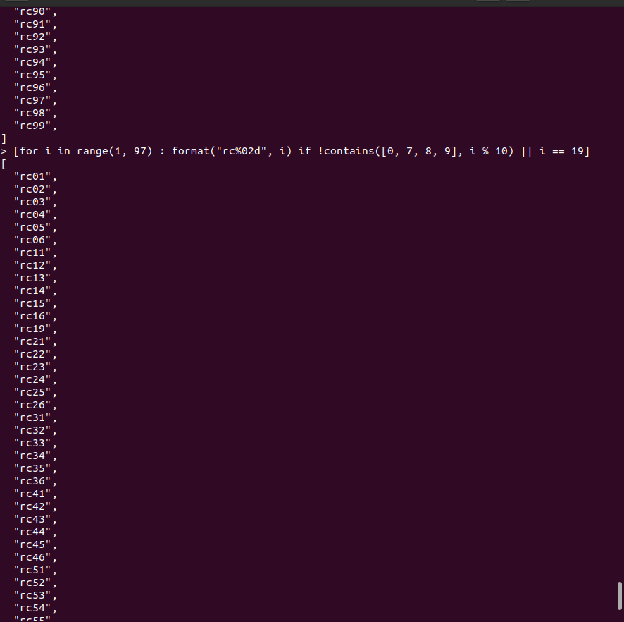

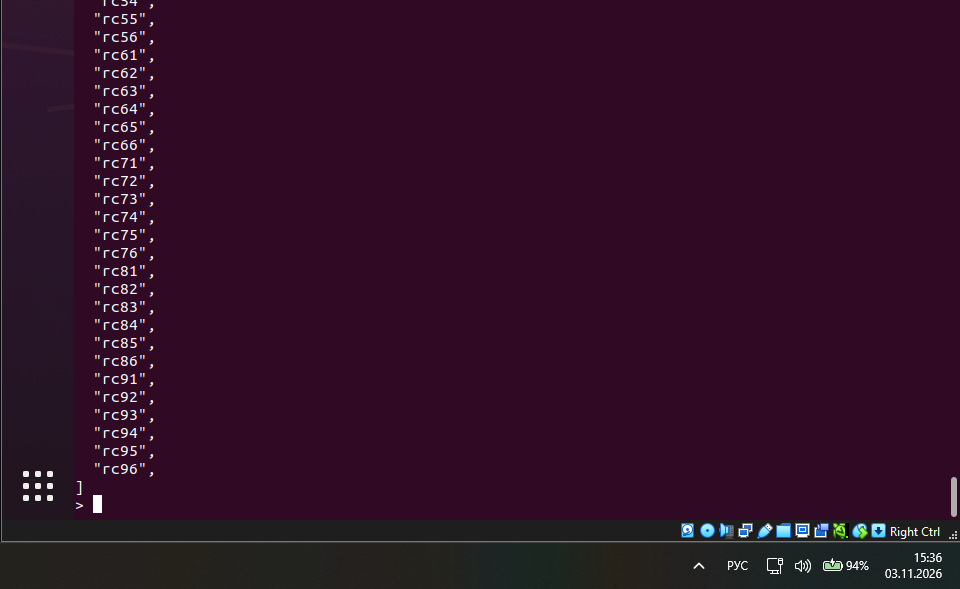

## Удаление ресурсов

После всех проверок сделал terraform destroy (удалилось 13 ресурсов), потом удалил сервисный аккаунт terraform-sa с ключом. В облаке пусто: нет ВМ, дисков, сетей и подсетей.


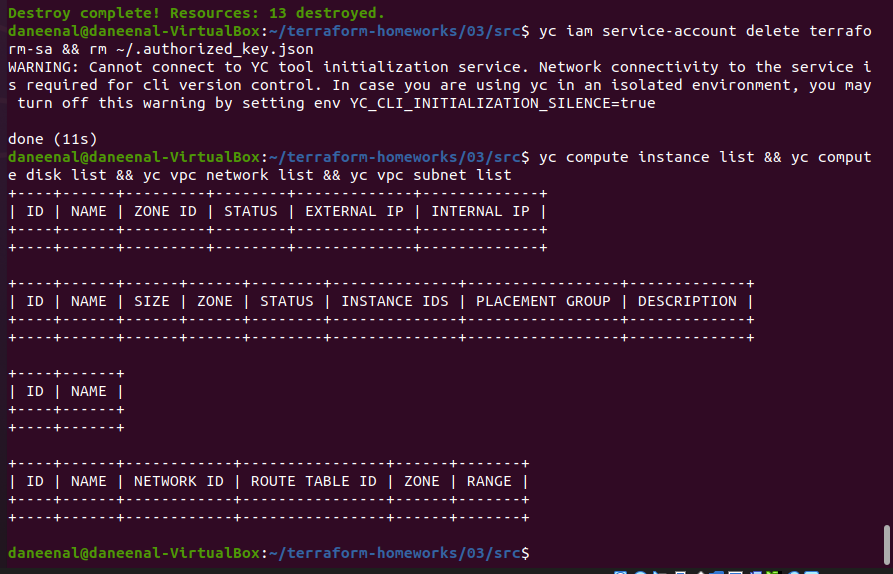

## Полный код проекта

Весь код лежит в папке src, ниже он же целиком. Файл personal.auto.tfvars не публикую, он в .gitignore.

### providers.tf

```
terraform {
  required_providers {
    yandex = {
      source = "yandex-cloud/yandex"
    }
  }
  required_version = ">= 1.12.0"
}

provider "yandex" {
  service_account_key_file = file("~/.authorized_key.json")
  cloud_id  = var.cloud_id
  folder_id = var.folder_id
  zone      = var.default_zone
}```

### variables.tf

```
###cloud vars

variable "cloud_id" {
  type        = string
  description = "https://cloud.yandex.ru/docs/resource-manager/operations/cloud/get-id"
}

variable "folder_id" {
  type        = string
  description = "https://cloud.yandex.ru/docs/resource-manager/operations/folder/get-id"
}

variable "default_zone" {
  type        = string
  default     = "ru-central1-a"
  description = "https://cloud.yandex.ru/docs/overview/concepts/geo-scope"
}
variable "default_cidr" {
  type        = list(string)
  default     = ["10.0.1.0/24"]
  description = "https://cloud.yandex.ru/docs/vpc/operations/subnet-create"
}

variable "vpc_name" {
  type        = string
  default     = "develop"
  description = "VPC network&subnet name"
}
###common vm vars

variable "vm_image_family" {
  type        = string
  default     = "ubuntu-2004-lts"
  description = "Image family for all VMs"
}

variable "vm_platform_id" {
  type        = string
  default     = "standard-v3"
  description = "Platform id for all VMs"
}

variable "vm_preemptible" {
  type        = bool
  default     = true
  description = "All VMs are preemptible"
}

variable "vm_nat" {
  type        = bool
  default     = true
  description = "Assign external IP to VMs"
}

variable "vm_core_fraction" {
  type        = number
  default     = 20
  description = "Guaranteed vCPU share in percent"
}

variable "vm_user" {
  type        = string
  default     = "ubuntu"
  description = "User for ssh-keys in metadata"
}

variable "ssh_public_key_path" {
  type        = string
  default     = "~/.ssh/id_ed25519.pub"
  description = "Path to the public ssh key"
}

###web vms (count)

variable "web_vm" {
  type = object({
    name_prefix = string
    vm_count    = number
    cpu         = number
    ram         = number
    disk_volume = number
  })
  default = {
    name_prefix = "web"
    vm_count    = 2
    cpu         = 2
    ram         = 1
    disk_volume = 5
  }
  description = "Parameters of identical web VMs (count)"
}

###db vms (for_each)

variable "each_vm" {
  type = list(object({
    vm_name     = string
    cpu         = number
    ram         = number
    disk_volume = number
  }))
  default = [
    { vm_name = "main", cpu = 4, ram = 4, disk_volume = 10 },
    { vm_name = "replica", cpu = 2, ram = 2, disk_volume = 5 }
  ]
  description = "Different db VMs (for_each)"
}

###extra disks and storage vm

variable "extra_disks" {
  type = object({
    disk_count  = number
    name_prefix = string
    type        = string
    size        = number
  })
  default = {
    disk_count  = 3
    name_prefix = "disk"
    type        = "network-hdd"
    size        = 1
  }
  description = "Parameters of identical extra disks (count)"
}

variable "storage_vm" {
  type = object({
    name        = string
    cpu         = number
    ram         = number
    disk_volume = number
  })
  default = {
    name        = "storage"
    cpu         = 2
    ram         = 1
    disk_volume = 5
  }
  description = "Parameters of the single storage VM"
}

###ansible inventory

variable "inventory_template" {
  type        = string
  default     = "hosts.tftpl"
  description = "Template file for the ansible inventory"
}

variable "inventory_file" {
  type        = string
  default     = "hosts.ini"
  description = "Generated ansible inventory file"
}

variable "playbook_file" {
  type        = string
  default     = "playbook.yml"
  description = "Ansible playbook applied to all VMs"
}
```

### main.tf

```
resource "yandex_vpc_network" "develop" {
  name = var.vpc_name
}
resource "yandex_vpc_subnet" "develop" {
  name           = var.vpc_name
  zone           = var.default_zone
  network_id     = yandex_vpc_network.develop.id
  v4_cidr_blocks = var.default_cidr
}
data "yandex_compute_image" "ubuntu" {
  family = var.vm_image_family
}
```

### locals.tf

```
locals {
  ssh_public_key = file(var.ssh_public_key_path)

  metadata = {
    serial-port-enable = "1"
    ssh-keys           = "${var.vm_user}:${local.ssh_public_key}"
  }
}
```

### count-vm.tf

```
resource "yandex_compute_instance" "web" {
  count       = var.web_vm.vm_count
  name        = "${var.web_vm.name_prefix}-${count.index + 1}"
  platform_id = var.vm_platform_id

  resources {
    cores         = var.web_vm.cpu
    memory        = var.web_vm.ram
    core_fraction = var.vm_core_fraction
  }

  boot_disk {
    initialize_params {
      image_id = data.yandex_compute_image.ubuntu.image_id
      size     = var.web_vm.disk_volume
    }
  }

  scheduling_policy {
    preemptible = var.vm_preemptible
  }

  network_interface {
    subnet_id          = yandex_vpc_subnet.develop.id
    nat                = var.vm_nat
    security_group_ids = [yandex_vpc_security_group.example.id]
  }

  metadata = local.metadata

  depends_on = [yandex_compute_instance.db]
}
```

### for_each-vm.tf

```
resource "yandex_compute_instance" "db" {
  for_each    = { for vm in var.each_vm : vm.vm_name => vm }
  name        = each.key
  platform_id = var.vm_platform_id

  resources {
    cores         = each.value.cpu
    memory        = each.value.ram
    core_fraction = var.vm_core_fraction
  }

  boot_disk {
    initialize_params {
      image_id = data.yandex_compute_image.ubuntu.image_id
      size     = each.value.disk_volume
    }
  }

  scheduling_policy {
    preemptible = var.vm_preemptible
  }

  network_interface {
    subnet_id          = yandex_vpc_subnet.develop.id
    nat                = var.vm_nat
    security_group_ids = [yandex_vpc_security_group.example.id]
  }

  metadata = local.metadata
}
```

### disk_vm.tf

```
resource "yandex_compute_disk" "storage" {
  count = var.extra_disks.disk_count
  name  = "${var.extra_disks.name_prefix}-${count.index + 1}"
  type  = var.extra_disks.type
  size  = var.extra_disks.size
  zone  = var.default_zone
}

resource "yandex_compute_instance" "storage" {
  name        = var.storage_vm.name
  platform_id = var.vm_platform_id

  resources {
    cores         = var.storage_vm.cpu
    memory        = var.storage_vm.ram
    core_fraction = var.vm_core_fraction
  }

  boot_disk {
    initialize_params {
      image_id = data.yandex_compute_image.ubuntu.image_id
      size     = var.storage_vm.disk_volume
    }
  }

  dynamic "secondary_disk" {
    for_each = yandex_compute_disk.storage
    content {
      disk_id = secondary_disk.value.id
    }
  }

  scheduling_policy {
    preemptible = var.vm_preemptible
  }

  network_interface {
    subnet_id          = yandex_vpc_subnet.develop.id
    nat                = var.vm_nat
    security_group_ids = [yandex_vpc_security_group.example.id]
  }

  metadata = local.metadata
}
```

### ansible.tf

```
resource "local_file" "hosts_templatefile" {
  content = templatefile("${path.module}/${var.inventory_template}", {
    webservers = yandex_compute_instance.web
    databases  = values(yandex_compute_instance.db)
    storage    = [yandex_compute_instance.storage]
  })
  filename = "${abspath(path.module)}/${var.inventory_file}"
}

resource "null_resource" "ansible_provision" {
  triggers = {
    inventory = local_file.hosts_templatefile.content
  }

  provisioner "local-exec" {
    command    = "ansible-playbook -i ${abspath(path.module)}/${var.inventory_file} -u ${var.vm_user} ${abspath(path.module)}/${var.playbook_file}"
    on_failure = continue
    environment = {
      ANSIBLE_HOST_KEY_CHECKING = "False"
      ANSIBLE_TIMEOUT           = "10"
    }
  }
}
```

### hosts.tftpl

```
[webservers]
%{ for i in webservers ~}
${i["name"]} ansible_host=${coalesce(i["network_interface"][0]["nat_ip_address"], i["network_interface"][0]["ip_address"])} fqdn=${i["fqdn"]}
%{ endfor }
[databases]
%{ for i in databases ~}
${i["name"]} ansible_host=${coalesce(i["network_interface"][0]["nat_ip_address"], i["network_interface"][0]["ip_address"])} fqdn=${i["fqdn"]}
%{ endfor }
[storage]
%{ for i in storage ~}
${i["name"]} ansible_host=${coalesce(i["network_interface"][0]["nat_ip_address"], i["network_interface"][0]["ip_address"])} fqdn=${i["fqdn"]}
%{ endfor }
```

### outputs.tf

```
output "vms_info" {
  description = "Name, id and internal fqdn of VMs created with count and for_each"
  value = concat(
    [for vm in yandex_compute_instance.web : {
      name = vm.name
      id   = vm.id
      fqdn = vm.fqdn
    }],
    [for vm in values(yandex_compute_instance.db) : {
      name = vm.name
      id   = vm.id
      fqdn = vm.fqdn
    }]
  )
}
```

### playbook.yml

```
---
- name: Check connection to all VMs
  hosts: all
  gather_facts: false
  tasks:
    - name: Ping
      ansible.builtin.ping:

    - name: Show fqdn from inventory
      ansible.builtin.debug:
        msg: "{{ inventory_hostname }} fqdn={{ fqdn }}"
```

### console.tf

```
locals {
  vpc = {
    network_id = "enp7i560tb28nageq0cc"
    subnet_ids = [
      "e9b0le401619ngf4h68n",
      "e2lbar6u8b2ftd7f5hia",
      "b0ca48coorjjq93u36pl",
      "fl8ner8rjsio6rcpcf0h",
    ]
    subnet_zones = [
      "ru-central1-a",
      "ru-central1-b",
      "ru-central1-c",
      "ru-central1-d",
    ]
  }
}
```
